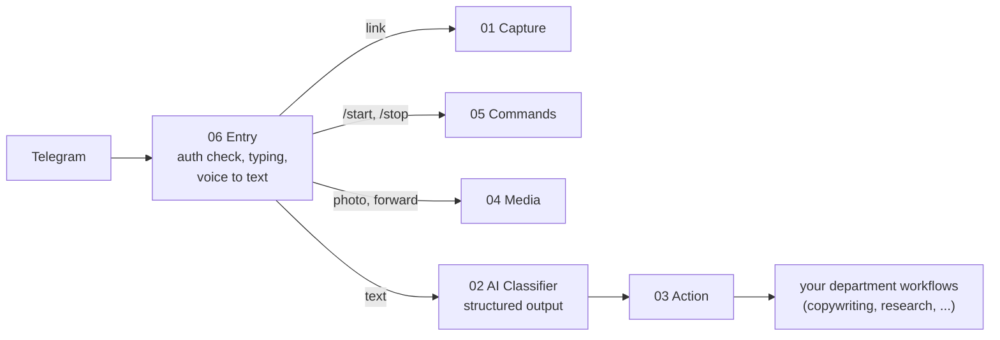

# n8n Multi-Agent Orchestrator

[](https://github.com/mike-prokhorov/n8n-multi-agent-orchestrator/actions/workflows/ci.yml)

Six [n8n](https://n8n.io) workflows that turn one Telegram bot into a routed multi-agent assistant. The entry workflow takes a message (text, voice or photo) and sends it where it belongs: links to capture, slash commands to the command handler, photos and forwards to media, and plain text to an LLM classifier that picks a department agent.

> Exported from a running n8n instance with every secret and instance id replaced by a placeholder. A test in CI keeps it that way.

---

## Architecture



Each workflow owns one job and is called with `executeWorkflow`, so you can redeploy or replace one without touching the others.

---

## Workflows

| File | Nodes | What it does |
|---|---|---|
| `workflows/06_qualifier.json` | 26 | Entry point. Telegram trigger, authorised-user check, typing indicator, voice transcription (OpenAI), then routes by message type to 01–05 |
| `workflows/01_capture.json` | 8 | For a link: fetches YouTube/TikTok metadata, saves it to `inbox`, replies to the user |
| `workflows/02_ai_classifier.json` | 14 | LLM agent (OpenAI) with a structured-output parser. Loads the chat's recent tasks and messages, returns `intent` and `department` |
| `workflows/03_action.json` | 19 | Dispatcher. Routes by intent and department, creates and updates rows in `tasks`, calls one of six department workflows |
| `workflows/04_media.json` | 9 | Photos and forwarded messages: saves them to `sent_messages` and asks the user what to do |
| `workflows/05_commands.json` | 7 | `/start` and `/stop`: replies and logs to `sent_messages` |

The six department workflows that 03 calls (copywriting, research, image gen, image edit, longwriter, reels ideas) are not in this repo. Plug in your own or remove the branches you don't need.

---

## Stack

- **n8n** with the LangChain nodes (`@n8n/n8n-nodes-langchain`) for the agent and the structured output parser
- **OpenAI**: chat model for the classifier, transcription for voice messages. Swap the `lmChat*` node to use another provider
- **Supabase** (Postgres): `public.inbox`, `smm_army.tasks`, `smm_army.sent_messages`, RPC `find_context_by_reply`
- **Telegram Bot API**

---

## Patterns worth stealing

1. **The entry workflow only routes.** It checks the user, shows "typing", turns voice into text and decides by message type. No business logic lives there.
2. **Structured output, not free text.** The classifier returns a typed `{intent, department}` payload, so the dispatcher switches on fields instead of parsing prose.
3. **`executeWorkflow` over webhook chains.** Calls stay inside n8n: no HTTP timeouts between workflows, and each one runs on its own for debugging.
4. **Context before classification.** The classifier loads the last tasks and messages of the chat, so "make it shorter" lands on the right task.
5. **The router contract is tested.** The classifier's allowed labels must equal the dispatcher's branches; CI fails if someone adds one without the other.

---

## Quick start

You need: an n8n instance with the LangChain nodes, a Supabase project, a Telegram bot token from @BotFather and an OpenAI API key.

1. **Create the tables.** The columns below are the ones the Supabase nodes read and write; adjust the types to your data.
   ```sql
   create table public.inbox (
     id bigint generated always as identity primary key,
     user_id text, chat_id text, message_id text, capture_type text,
     url text, domain text, title text, description text, author text,
     preview text, thumbnail_url text, tags text, user_note text,
     needs_firecrawl boolean default false,
     created_at timestamptz default now()
   );
   create schema if not exists smm_army;
   create table smm_army.tasks (
     id bigint generated always as identity primary key,
     user_id text, chat_id text, department text, status text,
     initial_prompt text, source_data jsonb, agent_output text,
     version int default 1,
     created_at timestamptz default now(), updated_at timestamptz default now()
   );
   create table smm_army.sent_messages (
     id bigint generated always as identity primary key,
     telegram_chat_id text, telegram_message_id text,
     message_type text, content_data jsonb,
     created_at timestamptz default now()
   );
   ```
   02 also calls the RPC `find_context_by_reply` to find the task a reply refers to. Write your own or delete that node.
2. **Create credentials** in n8n: Telegram API, Supabase API, OpenAI. Re-link them in the imported nodes.
3. **Import** in this order: `01`, `02`, `04`, `05`, `03`, then `06` last.
4. **Replace the placeholders:**

   | Placeholder | Where | Put |
   |---|---|---|
   | `<…-workflow-id>` | Execute Workflow nodes in 03 and 06 | pick the imported workflow from the list |
   | `<TELEGRAM_BOT_TOKEN>` | 06, node `HTTP typing...` | your bot token |
   | `<BOSS_USER_ID>`, `<TG_USER_ID>` | 06, node `Check Authorized User` | your Telegram user id |
   | `<webhook-uuid>` | 06, node `Telegram Trigger` | a fresh UUID (`uuidgen`) |
   | `https://your-project.supabase.co` | 02, HTTP node | your Supabase URL |
5. **Activate `06`** and send the bot a link. A new row should appear in `inbox`. Then send a plain text request: the classifier picks a department and a row appears in `smm_army.tasks`.

---

## Tests

```bash
python -m unittest discover -s tests -v
```

`tests/test_workflows.py` checks that all six workflows are present and their connections point to existing nodes; that the classifier's `intent` and `department` labels match the dispatcher's branches; that 06 only calls workflows from this repo; and that no file contains a token, key, credential id, workflow id, webhook id or runtime state. CI runs it with a [gitleaks](https://github.com/gitleaks/gitleaks) scan of the full history on every push and pull request.

---

## What this repo is **not**

- Not a one-click installer: credentials, placeholders and the database are yours to set up.
- Not a finished product: prompts and routing labels are minimal examples, swap them for your domain.
- Not tied to any business: users, projects and chat ids are placeholders.

---

## License

MIT, see `LICENSE`. No warranty; you wire it up to your stack.
